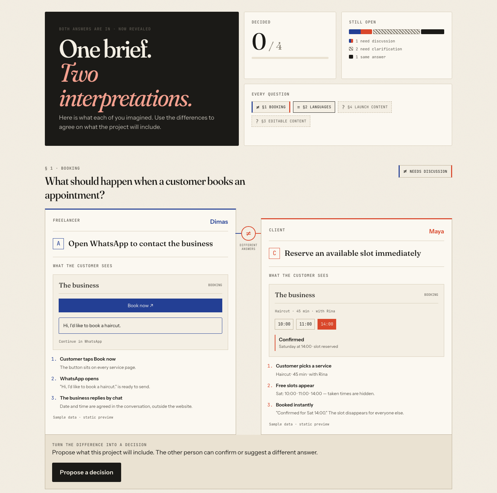
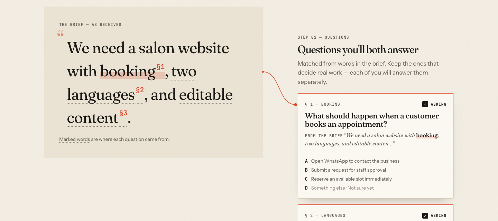
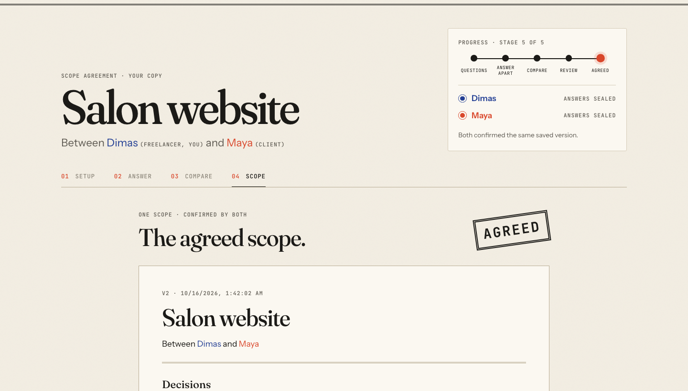

# ScopeMatch

Two people read the same brief. They rarely picture the same thing.

ScopeMatch helps a freelancer and a small-business client answer the same scope questions independently, reveal differences, and confirm one exportable scope before work starts. The proof of concept uses eight curated scenarios: booking, languages, editable content, launch content, payments, delivery, contact, and domain and hosting. The salon demo brief matches the first four.



| Where each question came from | One saved version, confirmed by both |
|---|---|
|  |  |

Screenshots come from the automated two-role browser test below, using the sample salon brief.

## What works

- Paste a brief, see deterministic keyword matches, and select relevant questions.
- Lock the questions and share a separate private client link; no account required.
- Answer independently. The server omits the other person's answers until both submit; submitted answers are sealed.
- Compare with **Same answer**, **Needs discussion**, and **Needs clarification**, plus static booking previews.
- Propose, counter-propose, and confirm decisions. Matching answers still need both confirmations.
- Edit the assembled scope, send a saved version, and confirm that exact version with names and timestamps.
- Stamp the scope **AGREED**, lock changes, and download the stored version as Markdown.

Confirmation records are labelled **recorded, not identity-verified**. Booking previews contain sample data; they do not make reservations. Brief matching uses a fixed library and needs no API key. Optional Gemini suggestions are described below.

## Run locally

Requirements: **Go 1.26.3** and **Node 24** with npm. Dependencies are locked in `go.sum` and `package-lock.json`.

Development, in two terminals from the repository root:

```sh
cd scopematch_BE
go run ./cmd/server
```

```sh
cd scopematch_FE
npm ci
npm run dev -- --host
```

Open <http://localhost:5173>. Vite forwards `/api` to the Go server on port 8080. Fonts are self-hosted; no external service is needed once dependencies are installed.

### One server, including the website

```sh
cd scopematch_FE
npm ci
npm run build
cd ../scopematch_BE
go run ./cmd/server -static ../scopematch_FE/dist
```

Open <http://127.0.0.1:8080>. Direct owner/client links and reloads work through the SPA fallback. Stop the server with Ctrl+C.

### Start a fresh demo project

After building the frontend:

```sh
cd scopematch_BE
go run ./cmd/server -static ../scopematch_FE/dist -db data/demo.db -seed-demo
```

The terminal prints the private freelancer link for a new salon project in Setup. Every `-seed-demo` run adds a new project; it does not erase existing projects. Opening that link also remembers the project in this browser.

Flags: `-addr :8080`, `-db data/scopematch.db`, `-static <built-directory>`, and `-seed-demo`. If port 8080 is occupied, the built-site command can use `-addr :8081`; the printed demo link follows that port.

## Try the core journey

1. Create a project using **Use the salon example**, or open the printed demo link. Keep the four suggested questions and select **Lock questions & get links**. Save the freelancer link; share only the client link.
2. Open the client link in a separate browser/private window. As freelancer choose **A — Open WhatsApp** for Booking; as client choose **C — Reserve immediately**. Choose A for the other questions on both sides.
3. Seal the freelancer answers first: the freelancer waits and the client cannot see those answers. Seal the client answers. Compare appears automatically, with the A/C booking previews and **Needs discussion**.
4. Propose **B — Submit a request for staff approval** for Booking; the other person confirms. For each matching-answer question, both people select **Confirm decision**. Counter-proposals are also supported and replace earlier confirmations.
5. At **4 of 4 decided**, the freelancer selects **Review scope**, edits any summary item, and selects **Send for confirmation**.
6. Both people review the same version and confirm with their names. **AGREED** appears. Download Markdown and check that it matches the saved scope.
7. To exercise versioning before agreement: confirm as one person, edit as a new version, then confirm that new version on both sides. Reopening a decision also requires a fresh scope version.

The reveal plays once per private link in a browser. Use a fresh private window/project to replay it. Reduced-motion settings replace the flip and stamp motion with fades. Try `/c/not-a-valid-token` to see the invalid-link page.

## Optional: AI question suggestions (Gemini)

The curated library covers common small-business questions. For briefs it doesn't cover, the freelancer can ask Gemini to **draft** up to three extra questions on the setup screen. Each option has expandable scope details so its included/excluded work, client responsibilities, and acceptance criteria can be reviewed before Add. AI only suggests: each draft is reviewed and added or discarded by the freelancer, re-validated by the server, and labelled as AI-suggested. It never answers, decides, or approves anything, and the rest of the app works without it.

To enable it, create `scopematch_BE/.env` (gitignored; see `.env.example`):

```sh
GEMINI_API_KEY=your-key-from-ai-studio
# optional: models to try in order, comma-separated
GEMINI_MODEL=
```

When a model answers "rate limited" (per-minute or daily free-tier quota) or "not available", the server skips it for a while and tries the next one. The configured default order is `gemini-3.5-flash-lite`, `gemini-3.1-flash-lite`, `gemini-3.8-flash`, `gemini-3.6-flash`, `gemini-3-flash-preview`. Availability and quotas vary by account; override the order with `GEMINI_MODEL` if necessary.

Restart the server; it logs `AI question suggestions: on` with the fallback order. Pressing the button sends the brief text to Google Gemini; on Gemini's free tier Google may use it to improve its products, and the screen says so before anything is sent.

With the built server and isolated Chrome already running, `node scripts/record-ai.mjs` captures a real AI request, option review, discard, Add, and persistence after reload. Set `SCOPEMATCH_DEMO_ORIGIN` for a non-default port. It uses a disposable bakery brief and the server's configured provider, without reading the key; silent supplementary footage and capture metadata go to ignored `artifacts/ai-demo/`. Provider failures stop the recording. This is automated footage, not user research or a complete submission video.

## Use a phone

With the laptop and phone on the same Wi-Fi, use the laptop's LAN address instead of `localhost` in the client link. For the development server, Vite prints its network address when started with `--host`. The built Go server listens on all interfaces by default. Keep the port and `/c/<token>` path when replacing the address.

For a temporary public test, run the built-site command, install [cloudflared](https://developers.cloudflare.com/tunnel/downloads/), and in another terminal run:

```sh
cloudflared tunnel --url http://127.0.0.1:8080
```

Open the printed HTTPS address before creating a project, so copied links use that address. For an existing project, replace only the origin, preserving `/o/<token>` or `/c/<token>`. The temporary hostname changes on a new tunnel and stops working when the tunnel stops. See [Cloudflare Quick Tunnels](https://developers.cloudflare.com/tunnel/get-started/quick-tunnels/).

## Checks

```sh
cd scopematch_BE
go test ./...
go vet ./...
```

```sh
cd scopematch_FE
npm run build
```

### Two-role browser test

`scripts/e2e.mjs` drives real Chrome with two isolated sessions — the freelancer on a 1440px desktop and the client on a 390px phone — through the whole salon journey: validation, card selection, lock, sealed answers, reveal, counter-proposals, same-answer confirmations, a revised scope version, AGREED, and identical exports from both sides. From the client page it also probes access rules (owner-only routes, tampered token, outdated version, writes after agreement). Every screen is checked for horizontal overflow and runtime errors; the script exits non-zero on any failure.

```sh
# Terminal 1: built app on :8080
cd scopematch_FE && npm run build
cd ../scopematch_BE && go run ./cmd/server -static ../scopematch_FE/dist -db data/e2e.db
```

```sh
# Terminal 2: separate headless Chrome profile (macOS path shown)
"/Applications/Google Chrome.app/Contents/MacOS/Google Chrome" --headless=new --disable-gpu \
  --no-first-run --user-data-dir=/private/tmp/scopematch-e2e-browser --remote-debugging-port=9223 about:blank
```

```sh
# Terminal 3, from the repository root (Node 24)
node scripts/e2e.mjs
```

Screenshots and the exported Markdown are written to the ignored `artifacts/e2e/` folder. Override with `SCOPEMATCH_E2E_ORIGIN`, `SCOPEMATCH_CDP_ORIGIN`, or `SCOPEMATCH_E2E_OUTPUT`.

Backend tests exercise token/role isolation, the server-side reveal gate, all 25 answer-pair statuses, proposal replacement, two-party decisions, version resets, stale-decision rejection, concurrent confirmations, immutable agreed exports, validation, and static serving.

## Architecture

This project uses **Clean Architecture**. The backend use cases depend on domain records and an application-owned repository interface; SQLite and HTTP are outer adapters. The frontend separates models, gateway contracts, HTTP implementation, and presentation, with dependency injection in `main.tsx`.

[Architecture boundaries and checks](docs/architecture.md) document the dependency direction. [AGENTS.md](AGENTS.md) makes this required for future work; `CLAUDE.md` imports the same rules. The frontend build runs architecture checks automatically; the Go suite checks backend imports.

## Code and data

- `scopematch_FE/src/pages/OwnerWorkspace.tsx`: role-specific navigation and project stages.
- `scopematch_FE/src/components/`: answers, Compare, proposals, versioned scope, and motion.
- `scopematch_FE/src/domain/` and `src/application/`: frontend models, gateway contract, and semantic errors.
- `scopematch_FE/src/api/client.ts`: HTTP gateway adapter, injected through `src/lib/gateway.tsx`.
- `scopematch_BE/internal/domain/`: persistence-neutral project, answer, proposal, and version records.
- `scopematch_BE/internal/scope/`: use cases, repository port, response visibility, versions, and Markdown export.
- `scopematch_BE/internal/store/`: SQLite repository implementation and idempotent startup schema.
- `scopematch_BE/internal/library/cards.json`: curated questions, option scope text, and booking previews.
- `devpost/`: approved scope, PRD, technical spec, and build checklist. Open [the offline code map](devpost/app-map.html) in a browser for a three-stop reference route.

Projects and all agreement records live in the SQLite file on the server. The Projects list stores owner links in this browser's local storage; it is a convenience, not a login or backup. Losing the private owner link loses freelancer access. Keep the database file and owner link to resume later.

The proof of concept is one freelancer and one client per project, with no accounts, chat, notifications, payments, or editing an agreed scope. Final user review and submission preparation are tracked separately in `devpost/checklist.md`.

## Video motion assets

[Motion tooling](scripts/motion/README.md) renders an original 8-second 3D intro and 6-second closing with synchronized stereo sound. It uses the app's paper/two-ink identity and existing text. Rendered MP4s, separate WAV sound masters, and previews stay under ignored `artifacts/motion/`; no app data or API keys are used.

[Application demo tooling](scripts/demo/README.md) produces the complete working-app
walkthrough in the original full-screen preview format. The demo contains only
application footage; the separately requested intro/closing stay separate.
English voice-over text and timing are delivered independently, with no generated
narration audio.

## License

Project code is available under the [MIT License](LICENSE). Dependencies and fonts retain their own licenses. See [third-party notices](THIRD_PARTY_NOTICES.md) for the copied Devpost Learn Skill Pack.
